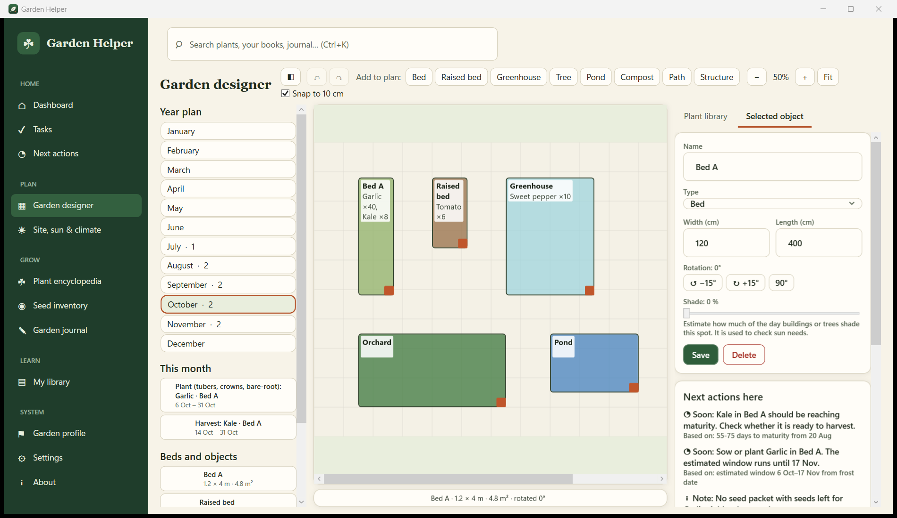
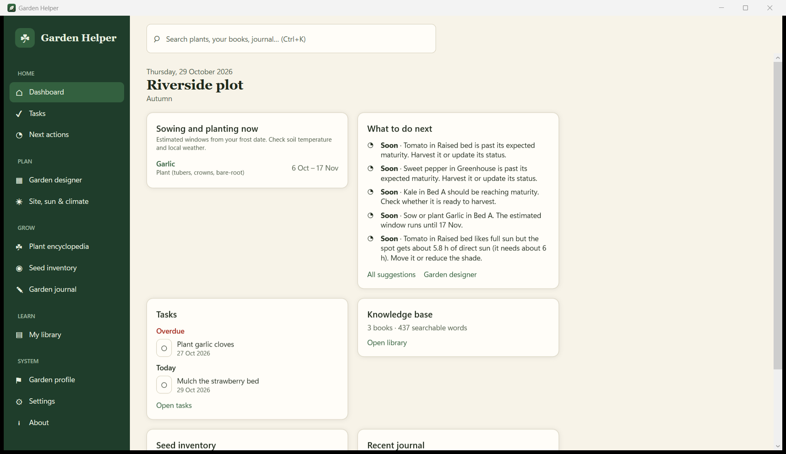
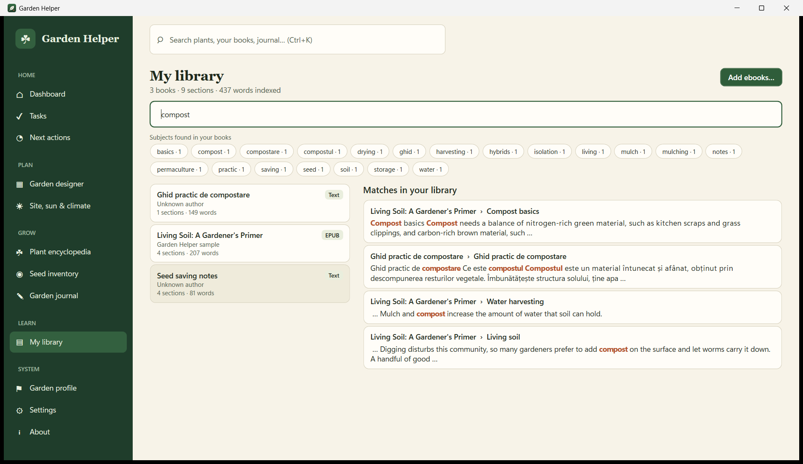

# Garden Helper

An offline Windows companion for growing your own food. Plan your beds on a scaled garden canvas, get sowing windows from your own frost dates, keep a journal and a seed inventory, and build a personal **knowledge base from your own ebooks** that you can search word by word.



| Dashboard | Personal library and search |
|---|---|
|  |  |

## What it does

- **Garden designer** — a scaled 2D plan with beds, raised beds, greenhouses, trees, ponds, compost areas and paths. Drag, resize, rotate, snap to 10 cm, undo/redo, zoom and pan. Overlap warnings. Three panels: year/month planner, canvas, plant library (drag a plant onto a bed; the quantity comes from the species' spacing).
- **Crop rotation check** — every planting is checked against the bed's history using editable family rules (`content/rotation-rules.json`). Verdicts are *compatible*, *caution*, *conflict* or *not enough information*, each with the reason. You can always proceed; an override is recorded.
- **Next actions** — transparent rules over your plantings, frost dates, sun and seeds (sowing window open or closing, harvest due, frost approaching for tender crops, too little sun, no seed left). Every suggestion shows the data it used.
- **Site, sun and climate** — enter coordinates; sun path, day length and noon sun height are calculated **offline**. Optionally (one explicit click) fetch a satellite picture and real temperature history, from which typical frost dates, monthly temperatures and degree days are derived.
- **Property map** — a satellite map (online, only after you agree) where you click 3 to 20 pins around your property. Drag pins to adjust; area and perimeter update live; one click imports the outline into the designer at true scale, and beds placed outside it are flagged. Positions come from imagery, so they are approximate, not survey-grade.
- **Plant encyclopedia** — 106 starter records in English and Romanian covering vegetables, herbs, cover crops, fruit and nut trees, berries, vines and cultivated mushrooms commonly grown in Romania, with sowing windows, spacing, companions (with evidence level), cautions and sources. It is a practical starter set, not an exhaustive flora: add your own with plain JSON files.
- **My library (knowledge base)** — import ebooks and documents, read them in the app, and search every word across all of them. Subjects are extracted for each book. Search ignores accents and capitals (`samanta` finds `sămânță`).
- Tasks, journal, seed inventory, weekly automatic backup with verification, restore, English/Romanian, light/dark themes, metric/imperial.

### Supported ebook and document formats

EPUB, PDF (text-based), MOBI/AZW/PRC (uncompressed or PalmDOC-compressed), FB2, DOCX, ODT, RTF, HTML, TXT, Markdown, CBZ (readable, not searchable).
Not supported: DRM-protected files, scanned PDFs without a text layer (they open but cannot be searched), Huffman-compressed MOBI, KF8-only AZW3, DJVU, LIT. Convert those to EPUB or PDF first (for example with Calibre).

## Requirements

Windows 10 or 11, 64-bit. The installer is self-contained: no .NET install needed. Books are displayed with the Microsoft WebView2 runtime (included with Windows 11 and current Windows 10); without it the reader falls back to plain text.

## Install

Download `GardenHelper-Setup-<version>.exe` from the [Releases](https://github.com/unupunct/Garden-Hepler/releases) page, or use the portable ZIP. Uninstalling never deletes your data.

## Where your data lives

`%LOCALAPPDATA%\GardenHelper\` — `gardenhelper.db` (SQLite), `library\` (copies of your books), `site\` (satellite picture), `backups\`, `logs\`, `content\` (your own plant files). Copy this folder to move everything to another PC. To remove all data, delete it after uninstalling.

**Backup and restore:** Settings → *Back up now* creates a verified copy of the database. A weekly automatic backup (last 10 kept) runs at start-up. *Restore…* takes effect the next time the app starts, and the current database is kept as a safety copy first.

## Privacy and optional online features

Nothing is sent anywhere unless you press **Fetch satellite picture and climate** on the Site page and confirm. Then only your coordinates are sent to:

- Esri World Imagery tiles (`server.arcgisonline.com`) — satellite picture, with attribution shown. Check Esri's terms for your use; the picture is stored locally and is not part of this repository.
- Open-Meteo historical archive (`archive-api.open-meteo.com`) — free, no key, for non-commercial use.

Both are isolated in `GardenHelper.Core/Site` behind small classes so another provider can replace them. The designer and every other feature work fully offline.

## Build from source

Requires the .NET 10 SDK.

```powershell
dotnet build GardenHelper.sln -c Release
dotnet test tests/GardenHelper.Tests
dotnet run --project src/GardenHelper.App
```

## Create the installer

Requires [Inno Setup 6](https://jrsoftware.org/isinfo.php).

```powershell
pwsh scripts/build.ps1      # tests, self-contained publish, portable ZIP, installer -> dist\
```

## Add plants and content

Drop JSON files in `%LOCALAPPDATA%\GardenHelper\content\plants\` (same format as `content/plants/*.json`). They are loaded at start-up and override built-in ids. See [docs/CONTENT.md](docs/CONTENT.md).

## Feature status

| Area | Status |
|---|---|
| Designer canvas: beds/objects, drag, resize, rotate, snap, undo/redo, zoom/pan, overlap warnings, persistence | **Done** |
| Plant library panel with drag-to-bed and spacing-based plant count | **Done** |
| Month planner (sowing windows, harvest spans from saved plantings) | **Done** |
| Crop rotation check with explanations and recorded overrides | **Done** (check per planting) |
| Next-action alerts, sun estimate from coordinates, climate/frost derivation, satellite picture | **Done** |
| Ebook library, reader, full-text and subject search | **Done** |
| Multi-year rotation *planner* (generate future sequences), succession planting | Planned |
| Property outline from map pins (3–20), live area/perimeter, import into the designer at true scale | **Done** |
| Georeferencing with control points and scale calibration, address search, projected CRS (UTM / Stereo 70), GeoJSON import | Planned |
| Shade simulation from obstacles, sunlight heatmap, automated bed planning, seasonal simulator | Planned |
| PNG/PDF plan export, labels, reports, GeoJSON import | Planned |
| Greenhouse, pond, mushroom, compost and soil modules | Planned |

Details in [docs/ROADMAP.md](docs/ROADMAP.md).

## Please note

Plant records are starter content compiled from widely published guidance; figures are typical ranges for temperate climates and must be checked against your local extension service. Planting dates are estimates. Never eat wild mushrooms or plants on the strength of an app.

## License

MIT — see [LICENSE](LICENSE). Third-party components: [THIRD-PARTY-NOTICES.md](THIRD-PARTY-NOTICES.md).
